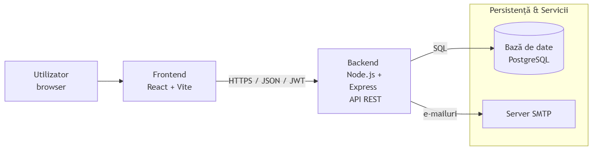
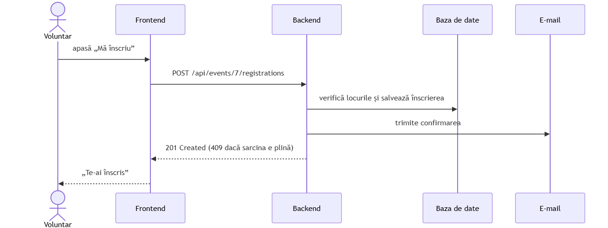

# Arhitectura aplicației

Turnout este o aplicație web structurată pe **trei niveluri**:
- **Frontend (Client):** Aplicație  realizată în **React cu Vite**, care rulează direct în browser-ul utilizatorului.
- **Backend (Server):** Server **Node.js cu Express**, care expune un API REST securizat.
- **Persistență (Bază de date):** Bază de date relațională **PostgreSQL**.

Comunicarea dintre Frontend și Backend se realizează exclusiv prin **HTTP (REST API)** cu mesaje în format **JSON**. Autentificarea cererilor se face pe bază de **token JWT** în header-ul `Authorization`. Pentru trimiterea e-mailurilor (confirmări, remindere), backend-ul folosește un server **SMTP extern**.

---

## 1. Arhitectura Generală a Sistemului

Diagrama de mai jos ilustrează principalele componente ale aplicației și modul în care acestea comunică:

### Componente și Responsabilități

| Componentă | Descriere / Responsabilitate |
|---|---|
| **Frontend (React + Vite)** | Interfața grafică (UI), gestionarea rutelor din browser și trimiterea cererilor către server. |
| **Backend (Node.js + Express)** | Logica de business, validarea datelor, securitatea (JWT, roluri) și trimiterea e-mailurilor. |
| **Bază de date (PostgreSQL)** | Stocarea persistentă a datelor (utilizatori, evenimente, înscrieri, donații). |
| **Server SMTP** | Serviciu extern utilizat pentru trimiterea notificărilor prin e-mail. |

---

## 2. Rutele Principalelor Ecrane (Frontend)

Navigarea în aplicație este structurată pe bază de roluri de acces:

| Rută | Acces | Descriere |
|---|---|---|
| `/` | Public | Pagina principală (Acasă) |
| `/evenimente`, `/evenimente/:id` | Public | Vizualizare evenimente și detalii |
| `/campanii`, `/campanii/:id` | Public | Vizualizare campanii de donații |
| `/autentificare` | Public | Autentificare și creare cont |
| `/contul-meu` | Voluntar | Profil, evenimente înscrise, ore de voluntariat |
| `/donatiile-mele` | Donator | Istoricul donațiilor efectuate |
| `/coordonator/*` | Coordonator | Management evenimente, prezență voluntari, resurse |
| `/admin/*` | Administrator | Management utilizatori, roluri, rapoarte, jurnal de audit |

---

## 3. Flux de Comunicare: Înscrierea la un Eveniment

Diagrama de mai jos exemplifică modul în care datele circulă între nivelurile aplicației la efectuarea unei acțiuni reprezentative (înscrierea unui voluntar):

### Descrierea fluxului:
1. **Voluntarul** apasă butonul „Mă înscriu” din interfața React.
2. **Frontend-ul** trimite o cerere `POST /api/events/:id/registrations` însoțită de token-ul JWT.
3. **Backend-ul** verifică validitatea token-ului și rolul utilizatorului.
4. **Baza de date** verifică disponibilitatea locurilor și înregistrează înscrierea într-o tranzacție SQL safe.
5. **Serverul SMTP** trimite e-mailul de confirmare către voluntar.
6. **Backend-ul** întoarce răspunsul HTTP `201 Created`, iar interfața grafică se actualizează.

